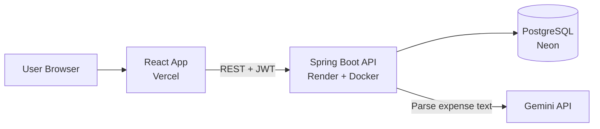
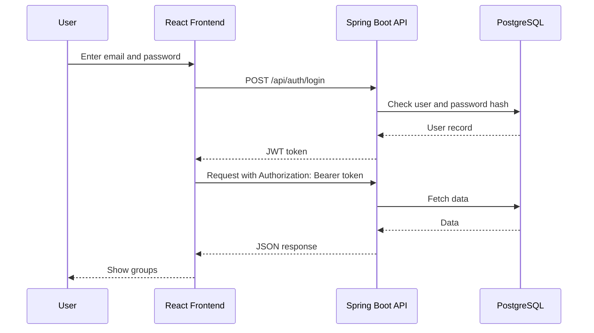
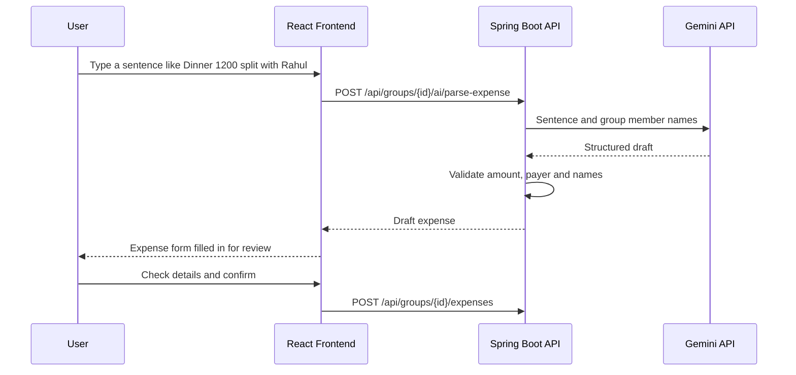
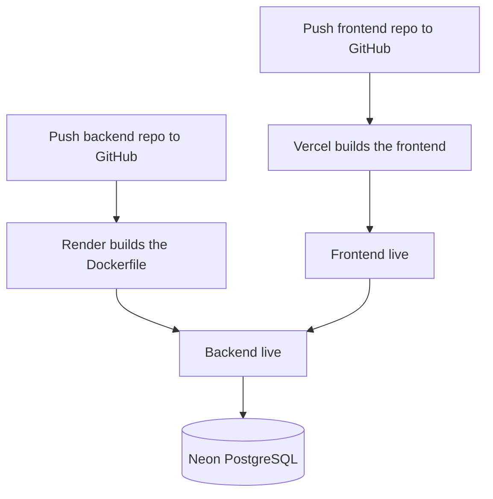

# Expense Splitter (Backend)

Expense Splitter is a full-stack app for sharing group expenses, like Splitwise. Friends create groups, add shared expenses, see who owes whom, and settle up with the fewest payments. An AI feature turns a sentence such as "Dinner 1200 with Rahul" into a draft expense.

This repository is the **backend API**. The React frontend is in a separate repository (linked below).

## Links

- **Live app:** https://expense-splitter-ui-three.vercel.app
- **Backend API:** https://expense-splitter-kyaa.onrender.com
- **Backend source code:** https://github.com/AkshayJ-2028/Expense-Splitter
- **Frontend source code:** https://github.com/AkshayJ-2028/expense-splitter-ui

> The backend runs on a free Render plan, so the first request after a period of inactivity can take up to a minute while the server wakes up.

## Features

- User registration and login with JWT authentication (passwords hashed with BCrypt)
- Create groups and add members by email. Only the group creator can add or remove members, or delete the group.
- Add expenses with three split types: **equal**, **percent** and **exact amount**
- Balance per member and a **settle-up plan with the fewest payments** (greedy algorithm)
- Record payments, and balances update automatically
- **AI expense entry:** type a sentence, get a draft expense (Gemini API)
  - The AI never saves anything. The user reviews the draft first.
  - The AI output is validated on the server, requests are rate limited, and a backup model is used if the first one is busy
- Delete a group together with its expenses, splits, payments and members in a single transaction
- Money is handled with `BigDecimal`, never floating point

## Tech Stack

| Layer | Technology |
|---|---|
| Frontend | React, Vite, React Router, Axios |
| Backend | Java 25, Spring Boot 4, Spring Security (JWT), Spring Data JPA |
| AI | Gemini API |
| Database | PostgreSQL on Neon (production), H2 file database (local) |
| Testing | JUnit, Maven |
| Hosting | Vercel (frontend), Render with Docker (backend) |

## Architecture



## How Authentication Works



## How the AI Expense Entry Works



The AI only fills in the form. Nothing is saved until the user confirms.

## How Settle-Up Works

For every member the app adds up what they paid and subtracts their share of each expense, which gives a balance: positive means they are owed money, negative means they owe money. A greedy algorithm then repeatedly matches the person who owes the most with the person who is owed the most. This clears all debts with the fewest payments. Recorded payments are subtracted from the balances automatically.

## API Overview

All endpoints except `/api/auth/*` need the header `Authorization: Bearer <token>`.

| Area | Endpoints |
|---|---|
| Auth | `POST /api/auth/register`, `POST /api/auth/login` |
| Groups | `POST /api/groups`, `GET /api/groups`, `GET /api/groups/{id}`, `DELETE /api/groups/{id}` |
| Members | `POST /api/groups/{id}/members`, `DELETE /api/groups/{id}/members/{userId}` |
| Expenses | `POST /api/groups/{id}/expenses`, `GET /api/groups/{id}/expenses`, `DELETE /api/groups/{id}/expenses/{expenseId}` |
| Balances | `GET /api/groups/{id}/balances` (member balances and the settle-up plan) |
| Payments | `POST /api/groups/{id}/payments` |
| AI | `POST /api/groups/{id}/ai/parse-expense` |

## Project Structure

```
expensesplitter/
├── src/main/java/com/expensesplitter/
│   ├── controller/      REST controllers
│   ├── dto/             Request and response objects
│   ├── entity/          JPA entities (groups, members, expenses, splits, payments, users)
│   ├── repository/      Spring Data repositories
│   ├── security/        JWT filter, token utility, current-user helper
│   └── service/         Business logic: splits, balances, groups, payments, AI
├── Dockerfile           Builds and runs the backend on Render
└── pom.xml              Maven configuration
```

## Run Locally

### Prerequisites

- Java 25

### Start the backend

From the project root:

```
./mvnw spring-boot:run
```

On Windows:

```
.\mvnw spring-boot:run
```

The API runs at `http://localhost:8080`. Locally it uses an H2 file database, so no database setup is needed.

**Optional, for the AI feature:** set `GEMINI_API_KEY` before starting.

```
:: Command Prompt
set GEMINI_API_KEY=your-key
```

```
# PowerShell
$env:GEMINI_API_KEY = "your-key"
```

### Start the frontend

The frontend lives in its own repository. See its README for the steps: https://github.com/AkshayJ-2028/expense-splitter-ui

### Run the tests

```
.\mvnw test
```

## Environment Variables (Production)

Set these on the backend host (Render):

| Variable | Description |
|---|---|
| `DB_URL` | JDBC URL of the PostgreSQL database (Neon) |
| `DB_USER` | Database username |
| `DB_PASSWORD` | Database password |
| `JWT_SECRET` | Long random string used to sign login tokens |
| `GEMINI_API_KEY` | Key for the AI feature |

Never commit real secrets to the repository.

## Deployment



- **Backend:** Render Web Service using the `Dockerfile`, with the environment variables above.
- **Database:** Neon PostgreSQL.
- **Frontend:** Vercel, with `VITE_API_URL` pointing to the Render backend. See the frontend README.

To try the Docker image locally:

```
docker build -t expense-splitter .
docker run -p 8080:8080 -e JWT_SECRET=change-me expense-splitter
```

## Author

Akshay Kumar Jha
GitHub: [AkshayJ-2028](https://github.com/AkshayJ-2028)
